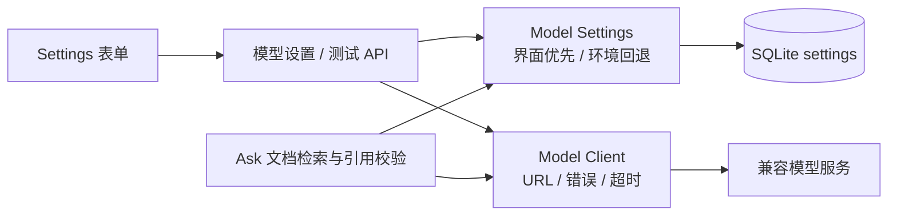

# Mark LLM 接入与增强规划

更新：2026-10-11。状态：**界面接入已实现；增强功能待确认后开发**。浏览器操作与构建验证以本轮实际记录为准。

## 1. 背景与边界

Mark 是个人知识源阅读器：公开 GitHub 仓库只读同步，文档具有路径和发布版本，笔记、书签及阅读记录独立保存。LLM 用于帮助理解、提炼和复核，输出须能回到原文；用户主动触发调用，保存个人内容须明确确认。

继续使用电脑 Web、React + Fastify + SQLite，以及原生 Node/systemd 部署。模型在配置的服务端运行，Mark 不要求 GPU。单一活动模型、统一兼容接口即可支持本轮功能。

## 2. 现状与本轮交付

| 能力 | 状态与实际边界 |
| --- | --- |
| 文档 Ask | 已有：关键词匹配、当前文档加权、最多 6 个片段，每片段最多 850 字符；回答校验引用编号 |
| 当前文档范围 | 当前 `documentId` 是检索加权，**并非严格仅检索本篇**；长文导读不能直接复用为“全文总结” |
| 引用版本 | 返回来源、路径、发布 SHA；前端目前打开当前文档，回答生成后的版本变化仍需完善 |
| LLM 界面配置 | 本轮实现：地址、模型、密钥、开关、测试、保存、放弃修改；保存立即影响后续 Ask |
| 模型接入 | 兼容 `POST {baseUrl}/chat/completions`，提交 `model/messages/stream:false`，解析文本回答；协议参考 [官方接口](https://developers.openai.com/api/reference/resources/chat/subresources/completions/methods/create) |
| 验证范围 | 自动化和本地模拟模型服务用于验证功能；实际服务商、真实密钥、费用与目标服务器发布另行验收 |

## 3. 设置页契约（本轮实现）

入口：**Settings → LLM 接入**。

| 字段 / 操作 | 规则 |
| --- | --- |
| 启用模型功能 | 关闭后保留配置；后续 Ask 不调用模型，阅读和关键词搜索继续可用 |
| API 接入地址 | HTTP/HTTPS 完整基础地址，保留 `/v1` 等实际路径；不要填完整 `/chat/completions`；地址不包含账号、密码、查询参数或锚点 |
| 模型名称 | 手填服务商模型 ID；“已配置”只表示字段保存，不代表连接已验证 |
| API 密钥 | 按服务要求填写；读取不返回密钥。留空保持已有密钥，勾选清除才删除；无密钥服务可以直接留空 |
| 地址变化 | 若已有密钥，须重新填写或明确清除，避免把旧密钥自动带到新地址 |
| 测试连接 | 使用当前表单和适用的已有密钥，发送一条简短消息，不发送文档或笔记，不保存配置；会产生一次模型调用 |
| 保存配置 | 在服务端 SQLite `settings.model_config` 保存完整配置，立即生效并在重启后保留；新请求用新配置，已发出的请求不自动重跑 |
| 配置优先级 | 尚无界面配置时读取 `MARK_MODEL_*`；保存后整个界面配置优先，包括关闭和明确清空密钥，不能回落到环境密钥 |
| 放弃修改 | 恢复到最后读取或保存的配置，不调用模型，不写入数据库 |
| 多标签页 | `revision` 防止旧页面覆盖新配置；冲突提示重新加载，保留当前输入 |

模型密钥保存在部署端运行数据库中，不使用浏览器持久化存储，不随 GET 响应或服务商错误正文回传；包含配置的数据库备份也须按运行数据保管。

### 加载与异常

| 状态 | 界面及数据行为 |
| --- | --- |
| 首次读取 | 局部骨架屏，其他设置可用；读取失败给重新加载入口 |
| 未配置 / 关闭 | 显示“未配置 / 已停用”；填写地址和模型后可测试，启用后可保存为活动配置 |
| 测试 / 保存中 | 展示进度文字，禁用重复操作和字段编辑，避免把测试结果贴到另一份输入上 |
| 测试成功 | 显示模型与耗时；草稿仍提示未保存，状态不冒充持久连接监控 |
| URL / 字段无效 | 原位提示，保留输入，不部分更新配置 |
| 密钥 / 模型错误 | 分别提示密钥无权限、接口或模型不存在；不改变应用登录状态 |
| 限流 / 不可达 / 超时 | 提示原因，允许手动重试；25 秒请求超时，不自动重复付费调用 |
| JSON / 回答格式不兼容 | 明确兼容接口问题，保留旧配置，不把原始服务商正文显示给用户 |

## 4. 增强功能优先顺序（规划）

| 阶段 / 功能 | 用户入口与输出 | 提交给模型的范围 | 可验证的完成条件 |
| --- | --- | --- | --- |
| P1-A 选段解释 | Reader 选中文字 → 解释；说明含义、前提和相关上下文 | 经校验的选段、本篇必要上下文、固定版本 | 仅引用本篇对应版本；脱离上下文的选段给出不足说明；原文和标注不被修改 |
| P1-B 本篇导读 | Reader → 导读；3–7 个要点、概念关系、建议阅读顺序 | 当前文档的章节和固定版本 | 每个要点能定位原文；长文若只处理部分，明确覆盖章节，不称为全文摘要 |
| P1-C 更新影响解读 | Updates 文档差异 → 解读；说明变更含义和建议复核的标注 | 同一 sync run 的前后版本、实际 diff、相关标注引用 | 内容与真实新增/修改/删除一致；模型建议不改变 `anchor_status` 或阅读完成状态 |
| P2-A 笔记草稿 | My Marks → 选择标注 → 整理；预览结构化学习笔记 | 明确选择的标注、笔记和对应原文版本 | 预览可改、可取消；明确保存才创建个人草稿，不覆盖原笔记或写回 GitHub |
| P2-B 跨来源对照 | Search / Ask → 指定 2–3 个来源；一致、差异、证据缺口表格 | 用户指定来源的命中文档片段 | 每项结论有各自引用；某来源无证据时显示缺口，不伪造对照 |
| P2-C 阅读自测 | Reader → 生成 3–5 题；先答后看解析与原文 | 当前章节和版本 | 用户先作答再展开答案；题目与解析可回溯；不自动判定已完成阅读 |
| P3 检索与调用优化 | 在已有功能验收后改进长文定位、语义召回和调用统计 | 经测量确认的必要索引与调用元数据 | 先准备 30 个中英文检索样例及正确证据，确认漏召回场景；有改善证据后再引入新索引 |

建议按 **P1-A → P1-B → P1-C → P2** 交付，每项独立关闭验收。P1 先补齐版本引用和范围约束，再增加模型入口。

## 5. 具体架构

### 已实现的接入链路

| 模块 | 已实现职责 |
| --- | --- |
| `server/model-settings.ts` | 校验、密钥保持/替换/清除、版本冲突、持久化、环境回退、连接测试 |
| `server/model-client.ts` | 统一非流式请求、25 秒超时、受控错误、文本响应解析 |
| `server/ask.ts` | 原有证据检索与引用校验；从每次请求获取的活动配置调用模型 |
| `server/app.ts` | `GET/PATCH /api/settings/model`、`POST /api/settings/model/test`；沿用登录与 CSRF |
| `src/App.tsx` / `src/api.ts` | 设置表单、配置状态、加载/失败反馈、类型契约 |

测试接口与保存接口互相独立；只检查 HTTP 可达或列出模型，不能代替一次实际文本生成测试。

### 增强阶段的共用层（待实现）

1. **Context Builder**：按任务严格限定文档、来源、选段、版本与篇幅；返回是否截断及实际覆盖范围。当前 Ask 上下文上限仍是 6×850 字符。
2. **Task Service**：分别实现解释、导读、差异解读等任务模板和结构校验；每种任务有独立验收样例。
3. **Evidence / Version Reader**：证据包含 `sourceId/documentId/path/sha/quote`；提供只读版本阅读入口。生成途中上游同步也不改变该请求的证据版本；版本不可读时明确提示。
4. **Draft Store**：P2 新增 `ai_artifacts`，记录任务、模型、提示词版本、证据版本和状态。原文与个人笔记使用现有写入流程；模型输出没有直接覆盖权限。
5. **缓存与调用记录**：缓存键包含任务、输入摘要、证据 SHA、接入地址/模型及提示词版本；输入或版本变化使缓存失效。实际使用量由服务商 `usage` 提供，缺失时显示未提供，不估造费用。

同步后旧回答可看，须标记引用已过期并可打开旧版本；知识源被移除、路径被删除或新链接待同步时，按发布版本读取，不能把不同仓库或不同版本混作当前依据。用户取消后丢弃迟到结果；向上游传播取消信号，计费以服务商实际行为为准。

## 6. 实施与验收清单

### 本轮界面接入

| ID | 验证动作 | 通过条件 / 证据 |
| --- | --- | --- |
| C01 | 无界面配置时读取设置 | 正确读取环境回退；GET 不含密钥；未配置显示空态 |
| C02 | 保存地址、模型、密钥并请求 Ask | 无需重启，实际请求使用新地址/模型/密钥，引用仍通过原有校验 |
| C03 | 修改草稿后测试、再放弃修改 | 请求使用草稿；测试不保存，不发送业务片段；放弃后恢复原配置 |
| C04 | 留空、替换、清除密钥，更换地址 | 留空保持；替换生效；清除后不回落到环境密钥；新地址须明确处理密钥 |
| C05 | 关闭并重启服务 | 配置保持关闭；Ask 不调用模型；搜索和阅读可用 |
| C06 | 注入 401/403、404、429、5xx、无效 JSON、空回答、超时和网络失败 | 有明确受控错误；不回传服务商私有正文、不部分保存，允许手动重试 |
| C07 | 两标签页持有同一旧 revision 后分别保存 | 第二次返回 409，不覆盖第一份配置，界面保留输入并提示重新加载 |
| C08 | 在电脑浏览器操作加载、测试、保存、失败和重试 | 状态与数据一致；禁重复请求；刷新后保留配置，密钥输入为空；无布局溢出或运行时错误 |

自动化入口：`tests/model-settings.test.ts`，配合 `npm test` 和 `npm run build`。C08 需浏览器证据；真实服务商接入、发布与运行验收须独立记录，不能用模拟服务替代。

### 后续增强（未完成）

- [ ] E01 先实现按版本阅读与严格上下文范围；生成时切换版本、移除来源均有独立样例。
- [ ] E02 选段解释只用确认范围；无依据、歧义、空选段及长选段均有明确结果。
- [ ] E03 导读要点可逐条打开对应段落；部分覆盖有提示，不虚称处理整篇。
- [ ] E04 差异解读固定前后 SHA；生成前后标注、原文与完成状态完全不被自动改写。
- [ ] E05 笔记草稿的生成、编辑、取消、明确保存分别测试；取消不新增/覆盖个人记录。
- [ ] E06 跨来源每个引用可核查；某来源没有证据时保持可见缺口。
- [ ] E07 自测先作答后展开解析；再次生成和取消不会把文档标记为已完成。
- [ ] E08 失败不隐藏正文；重复点击、取消、迟到响应、缓存版本失效均有独立验证。

## 7. 当前交付限制

增强表中的选段解释、导读、更新解读、笔记草稿、对照、自测和版本引用阅读尚未实现。本轮只交付设置页接入并复用原有 Ask，后续按上述阶段确认后开发。
